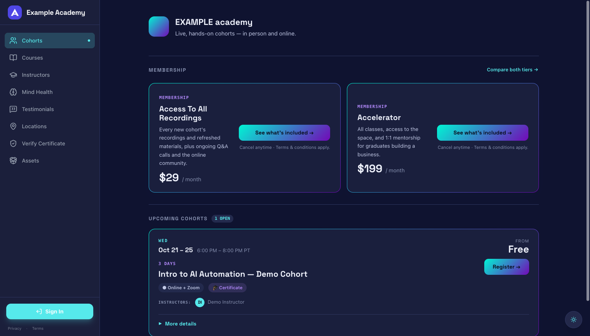

# Hub

An open-source platform for running a cohort-based academy: the LMS your students learn in,
the lead engine that fills your cohorts, and the back office that takes payments, books your
space and keeps instructors on schedule. One Next.js app, one SQLite file.

License: [AGPL-3.0](./LICENSE).



## What's inside

**Learning (LMS)**
- Programs → modules → lessons (text and video) with materials, quizzes and graded assessments,
  lesson progress, course reviews, learning paths.
- Cohorts with seat tiers, enrollments, Zoom-linked live sessions and shared recurring session
  series, cohort materials and messages.
- Completion certificates from HTML templates, with public verification at `/verify`.
- Members area with membership tiers, pods, milestones, events and a recordings library;
  learner track records; public instructor and mentor profiles.
- Zoom cloud recordings imported automatically as lessons.

**Lead engine and communications**
- Branching onboarding quizzes (`/onboarding/[slug]`) that tag and route each lead.
- A built-in leads CRM (`/admin/contacts`) with first-touch UTM and ad click-id attribution,
  notes, timelines, pipeline statuses and AI lead briefs.
- Drip email and SMS campaigns with audience segments, send windows and exit rules; one-off
  broadcasts; signed open and click tracking; separate marketing and course consents.
- Public 1:1 booking links backed by closer availability, Zoom and Google Calendar.
- Server-side conversions to GA4 and Meta, plus Tag Manager support.

**Payments**
- Stripe hosted Checkout for cohort seats, including guest checkout (account created after
  payment), self-paced programs and recurring memberships.
- Coupons, abandoned-checkout recovery, refunds, purchase history and an admin sales report.
- Access is granted only by the verified Stripe webhook.

**Operations**
- Venue rentals: public calendar and event pages, registrations with waivers, e-signed rental
  agreements and Stripe payment links.
- Instructor scheduling: per-session proposals, accept/counter/confirm, Google Calendar sync and
  reminders.
- Telephony: a browser softphone for staff (Twilio Voice), inbound call routing, recordings and
  transcripts, and a Vapi AI voice receptionist and outbound AI calls.
- Cohort chat via Rocket.Chat.
- A headless content CMS with an agent control plane for an external static site.
- Admin → Integrations: rotate API keys and config at runtime, encrypted at rest.
- An authenticated MCP API so AI assistants can operate the hub ([below](#mcp-server)).

## Tech stack

- [Next.js](https://nextjs.org) 16.1 (App Router, Turbopack), React 19, TypeScript
- Prisma 6 with SQLite
- Auth.js (NextAuth v5): Google OAuth and email/password
- Tailwind CSS v4, Tiptap
- Stripe, Twilio, Vapi, Zoom, Google Cloud Storage, Google Calendar, Nodemailer (SMTP),
  Rocket.Chat, OpenRouter / OpenAI (all optional)
- Puppeteer + Chromium for PDFs, Pino for logs
- `bun test` for unit tests

## Quickstart

Needs Node.js 20+ and npm. No external services are required.

```bash
npm ci
cp .env.example .env   # the defaults boot locally: SQLite at prisma/dev.db, integrations off
npm run db:generate
npm run db:push
npm run seed:demo
npm run dev
```

`npm run seed:demo` creates a demo admin, `admin@example.com` / `admin1234`, plus a demo
program and cohort. Open http://localhost:3000/login and sign in. The seed is for local
databases only.

Always run Prisma through the `npm run db:*` scripts: they use the project's Prisma 6 (a global
Prisma 7 rejects this schema) and put the schema's generators on PATH. More detail, including integrations in development:
[docs/LOCAL_DEVELOPMENT.md](./docs/LOCAL_DEVELOPMENT.md).

## Make it yours

Every academy-specific value lives in three config files under `src/config/`:

| File | What goes there |
|------|-----------------|
| [`brand.ts`](./src/config/brand.ts) | Identity: name and wordmark, domains, contact emails and phone, address and venue, social links, agreement signer, legal venue, SMS sender prefix, timezone, machine-readable ids |
| [`content.ts`](./src/config/content.ts) | Business copy: membership tiers and prices shown on the site, self-paced page copy, testimonials, FAQ, certificate wording, cohort-page lines. Empty lists and strings hide the matching UI |
| [`catalog.ts`](./src/config/catalog.ts) | Deployment ids read from env: the self-paced program id, the free Q&A cohort id, the GTM container, the GCS image bucket. Empty switches the feature off |

The defaults are a neutral "Example Academy" on `your-academy.example`. A unit test
(`tests/unit/brand-config.test.ts`) fails if brand values are hardcoded anywhere else.

Then replace the brand assets:

| File | Used for |
|------|----------|
| `public/logo.png` | Square logo |
| `public/assets/big_logo.png` | Wide logo |
| `src/app/favicon.ico` | Favicon |
| `src/content/signatures/signature.png` | Countersignature on venue agreements |

Finally, review the legal texts in `src/content/legal/` (terms, privacy, waiver, conduct,
recording release, AI tools policy) and the agreement templates in `src/content/agreements/`
**with your own counsel** before going live. They are starting points, not legal advice.

## Integrations

Everything beyond the core is optional and switches on when its variables are set. Keys marked
in [docs/ENVIRONMENT.md](./docs/ENVIRONMENT.md) can also be set at runtime in Admin →
Integrations (`/admin/integrations`) instead of the environment; that store needs
`SETTINGS_ENC_KEY`.

| Integration | Enables | Variables |
|-------------|---------|-----------|
| Stripe | Seat checkout, guest checkout, memberships, coupons, refunds, venue rental payment links | `STRIPE_SECRET_KEY`, `STRIPE_WEBHOOK_SECRET`, optional `STRIPE_MEMBERSHIP_RECORDINGS_PRICE_ID`, `STRIPE_MEMBERSHIP_ACCELERATOR_PRICE_ID` |
| Google OAuth | "Continue with Google" sign-in | `GOOGLE_CLIENT_ID`, `GOOGLE_CLIENT_SECRET` |
| Google Cloud Storage | Media library, uploads, lesson media, generated covers | `GCS_PROJECT_ID`, `GCS_CLIENT_EMAIL`, `GCS_PRIVATE_KEY`, `GCS_BUCKET_NAME`, `NEXT_PUBLIC_GCS_BUCKET_NAME` |
| Google Drive | Course import from Drive folders, Drive picker | `GOOGLE_DRIVE_CLIENT_EMAIL`, `GOOGLE_DRIVE_PRIVATE_KEY`, `NEXT_PUBLIC_GOOGLE_API_KEY`, `NEXT_PUBLIC_GOOGLE_CLIENT_ID` |
| Google Calendar | Calendar invites for instructor sessions, bookings, venue events | `GOOGLE_CALENDAR_ID`, `GOOGLE_OAUTH_CLIENT_ID`, `GOOGLE_OAUTH_CLIENT_SECRET`, `GOOGLE_OAUTH_REFRESH_TOKEN`, `GOOGLE_CALENDAR_ORGANIZER_EMAIL` |
| Zoom | Recurring cohort meetings, session sync, recording import, booking meetings | `ZOOM_ACCOUNT_ID`, `ZOOM_CLIENT_ID`, `ZOOM_CLIENT_SECRET`, `ZOOM_WEBHOOK_SECRET`, `ZOOM_HOST_EMAIL` |
| SMTP | All email: transactional, drip, broadcasts, certificates, outreach | `SMTP_HOST`, `SMTP_PORT`, `SMTP_SECURE`, `SMTP_USER`, `SMTP_PASS`, `MAIL_FROM`, `DRIP_EMAIL_FROM` |
| Drip runner | Scheduled campaigns, cohort messages, instructor reminders; open/click tracking | `DRIP_CRON_TOKEN`, `DRIP_TRACKING_SECRET`, `DRIP_TRACKING_SALT` |
| Twilio | SMS, staff softphone, inbound call routing, recordings | `TWILIO_ACCOUNT_SID`, `TWILIO_AUTH_TOKEN`, `TWILIO_PHONE_NUMBER`, `TWILIO_API_KEY_SID`, `TWILIO_API_KEY_SECRET`, `TWILIO_TWIML_APP_SID`, `SMS_TRANSACTIONAL_ENABLED`, `SMS_OPTIN_CONFIRMATION_ENABLED`, `INBOUND_ROUTE_CHAIN`, `CLOSER_RING_STRATEGY`, `INBOUND_FORWARD_NUMBER` |
| Vapi | AI voice receptionist, outbound AI calls | `VAPI_API_KEY`, `VAPI_PHONE_NUMBER_ID`, `VAPI_DEFAULT_ASSISTANT_ID`, `VAPI_WEBHOOK_SECRET`, `VAPI_INBOUND_NUMBER` |
| Rocket.Chat | Cohort and member chat | `RC_URL`, `RC_ADMIN_USER_ID`, `RC_ADMIN_AUTH_TOKEN`, `RC_PASSWORD_SECRET` |
| OpenRouter | Onboarding analysis, lead briefs, email drafts | `OPENROUTER_API_KEY`, optional `AI_MODEL_LEAD_BRIEF`, `AI_MODEL_EMAIL_DRAFT` |
| OpenAI | Image and course cover generation | `OPENAI_API_KEY` |
| GA4 / Meta | Server-side `generate_lead` and `purchase` conversions, Meta pixel | `GA4_MEASUREMENT_ID`, `GA4_API_SECRET`, `META_PIXEL_ID`, `META_CAPI_TOKEN`, `META_TEST_EVENT_CODE` |
| Google Tag Manager | Browser tags | `NEXT_PUBLIC_GTM_ID` |
| n8n | Course ingestion and lesson audio extraction workflows | `N8N_WEBHOOK_URL`, `N8N_EXTRACT_AUDIO_WEBHOOK_URL`, `N8N_WEBHOOK_SECRET`, `N8N_CALLBACK_SECRET` |
| Content platform / agents | Headless CMS feed for a static site, external agents service | `CONTENT_INGEST_TOKEN`, `SITE_BUILD_TOKEN`, `SITE_BUILD_TRIGGER_URL`, `SITE_BUILD_TRIGGER_TOKEN`, `AGENTS_SERVICE_URL`, `AGENTS_SERVICE_TOKEN`, `AGENT_REPORT_TOKEN` |
| MCP API | AI-assistant access through the MCP server | `HUB_MCP_TOKEN`, `HUB_MCP_WRITES_ENABLED`, `HUB_ENV` |
| Grafana Faro / Loki | Browser telemetry, server log shipping | `NEXT_PUBLIC_TELEMETRY_URL`, `ALLOY_HOST`, `LOG_LEVEL`, `LOG_FILE_PATH` |
| GoHighLevel (legacy) | Optional sync of onboarding leads to an external CRM | `GHL_API_KEY`, `GHL_LOCATION_ID`, `GHL_UTM_*_ID` |

## Deployment

The repository includes a multi-stage [`Dockerfile`](./Dockerfile) (Node 20 Alpine with system
Chromium for PDFs, Next.js standalone output). Things to know:

- **Persist the database.** Point `DATABASE_URL` at a file on a persistent volume and run a
  single instance; SQLite is a single-writer file. Back it up.
- **Schema on start.** The image runs [`start.sh`](./start.sh), which applies the Prisma schema
  (`prisma db push`) and then starts the server. Schema changes ship this way; there are no
  migration files.
- **Configure webhooks** for each provider you enable (Stripe, Twilio, Vapi, Zoom).
- **Schedule the runners**: call `POST /api/internal/drip/tick` and
  `POST /api/internal/instructor/tick` every 15 minutes with
  `Authorization: Bearer $DRIP_CRON_TOKEN`.
- Terminate TLS in front of the container. The fastest path is the included compose file:

```bash
cp .env.example .env              # set AUTH_SECRET, NEXTAUTH_URL and the integrations you need
docker compose up -d --build      # app on 127.0.0.1:3000, database on a named volume
HUB_DOMAIN=hub.example.com docker compose --profile proxy up -d   # optional Caddy HTTPS
```

Full guide: [docs/DEPLOYMENT.md](./docs/DEPLOYMENT.md).

## MCP server

The hub exposes an authenticated MCP API (`/api/internal/mcp/v1/*`) so AI assistants such as
Claude Code or Claude Desktop can operate it: create cohorts, edit courses and lessons, work
leads, author drip campaigns, manage memberships and run venue events. Writes that change what
people see are previewed before they are committed.

On the hub, set `HUB_MCP_TOKEN` to a dedicated random value, and set
`HUB_MCP_WRITES_ENABLED=true` only when you want writes. A ready-made MCP server package for
this API is coming soon from the same maintainers; until then, the endpoints are documented in
[docs/MCP_API.md](./docs/MCP_API.md) and work with any HTTP client.

## Documentation

- **Humans:** start with [docs/README.md](./docs/README.md), which indexes architecture,
  conventions, environment variables, deployment, security design and every major feature.
- **AI coding agents** (Claude Code, Codex, Cursor and others): [AGENTS.md](./AGENTS.md) has the
  rules, commands and task recipes; `CLAUDE.md` points Claude Code at it, and
  [`llms.txt`](./llms.txt) is a compact map of the docs for any LLM.

## Contributing

See [CONTRIBUTING.md](./CONTRIBUTING.md). Before opening a pull request:

```bash
npx tsc --noEmit && bun test tests/unit && npm run build
```

CI runs the same three. `npm run lint` reports existing debt; don't add new findings.

## Security

Please report vulnerabilities privately as described in [SECURITY.md](./SECURITY.md). The
security design is documented in [docs/SECURITY.md](./docs/SECURITY.md).

## License

[GNU Affero General Public License v3.0](./LICENSE). If you run a modified version as a network
service, the AGPL requires you to offer your users the source of that version.

## About

The hub is built and maintained by [AI Start Academy](https://aistartacademy.com), which runs
its own academy on it, and is released as open source so other academies can run theirs.
